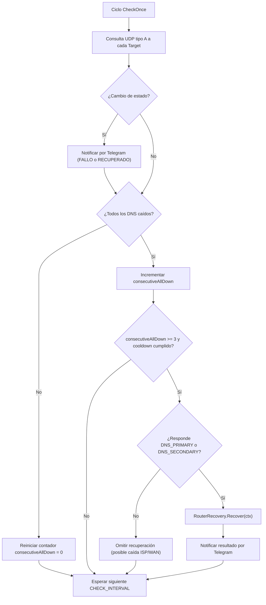

# Arquitectura y funcionamiento

Este documento describe la organización interna de `Local_DNS-DRP`, la validación de respuestas DNS y la secuencia de recuperación automática del router.

## Estructura del proyecto

```text
.
├── cmd/dns-monitor/        # Punto de entrada y manejo de señales (SIGINT/SIGTERM)
├── internal/
│   ├── config/             # Carga y validación estricta de variables de entorno
│   ├── dns/                # Consultas UDP A-record y validación de cadena CNAME
│   ├── monitor/            # Bucle de comprobación, alertas, fallback DNS y cooldown
│   ├── notify/             # Cliente Telegram con truncado y sanitización del token
│   └── recovery/           # Selector ROUTER_MODEL y adaptador Askey RTF8316VW
├── docs/                   # Documentación de arquitectura y descubrimiento de routers
├── Dockerfile              # Build multi-stage estático (scratch, linux/amd64 y arm64)
└── docker-compose.yml      # Despliegue endurecido con imagen multi-arquitectura
```

## Flujo de monitorización y recuperación



## Validación DNS (`internal/dns`)

Cada destino recibe una consulta UDP recursiva (`QTYPE=A`, `QCLASS=IN`) con identificador aleatorio (`crypto/rand`). `ValidateResponse` comprueba:

1. Longitud mínima de cabecera (`>= 12` bytes) y coincidencia de ID.
2. Bit `QR=1`, `Opcode=0`, `TC=0` (no truncada), `RCODE=0` (`NOERROR`) y `Z=0`.
3. Pregunta coincidente en nombre, tipo y clase.
4. Cadena de respuestas `ANCOUNT >= 1` resolviendo punteros de compresión (con detección de bucles) y siguiendo alias `CNAME` hasta un registro `A` válido.
