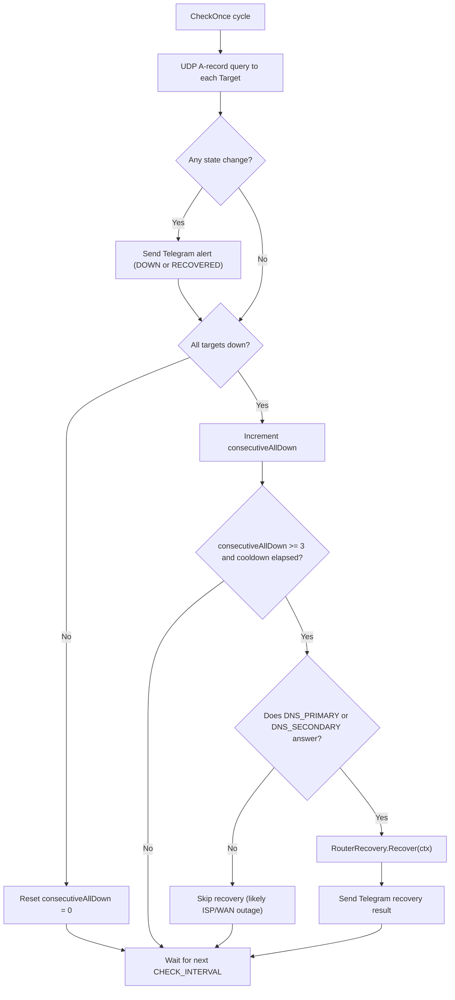

# Architecture & Internals

This document describes the internal package layout, DNS response validation, and disaster-recovery flow of **Local_DNS-DRP**.

## Package Layout

```text
.
├── cmd/dns-monitor/        # Entrypoint, signal handling (SIGINT/SIGTERM), wiring
├── internal/
│   ├── config/             # Strict env var parsing and validation
│   ├── dns/                # UDP A-record queries and CNAME-chain validation
│   ├── monitor/            # Polling loop, alert state machine, fallback probe, cooldown
│   ├── notify/             # Telegram Bot API client with token redaction
│   └── recovery/           # RouterRecovery interface, Askey & AsusWrt adapters
├── docs/                   # Architecture and router discovery guides
├── Dockerfile              # Multi-stage static build (scratch, amd64/arm64)
└── docker-compose.yml      # Hardened container deployment
```

## Monitoring & Recovery Flow



## DNS Health Check (`internal/dns`)

Each target receives a recursive UDP DNS query (`QTYPE=A`, `QCLASS=IN`) with a `crypto/rand` transaction ID. `ValidateResponse` accepts a response only when:

1. Header length is at least 12 bytes and the transaction ID matches.
2. `QR=1` (response), `Opcode=0`, `TC=0` (not truncated), `RCODE=0` (`NOERROR`), and `Z=0`.
3. The question section matches the queried domain, type, and class.
4. `ANCOUNT >= 1`, compression pointers have no loops, and following any `CNAME` chain leads to a valid `A` record for the queried name.

## Alert & Safety Guarantees

- **No alert spam:** notifications fire only on state transitions, startup, and shutdown.
- **Token redaction:** `internal/notify` strips `TELEGRAM_BOT_TOKEN` from `*url.Error` and any logged error strings.
- **Ambiguous write protection:** router adapters verify actual router state via read-back rather than trusting HTTP timeouts or optimistic 200 responses.
- **Safe Wi-Fi restoration:** the Askey adapter uses `sync.Once` with a bounded background context to re-enable Wi-Fi radios even if the monitor receives `SIGTERM` mid-recovery.
